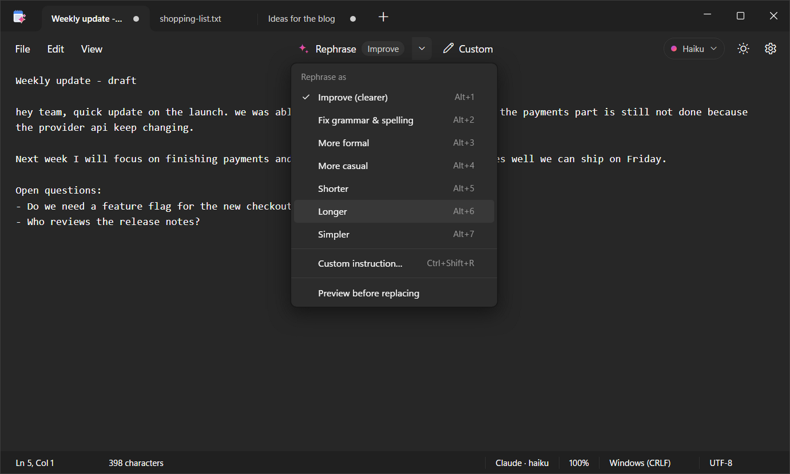
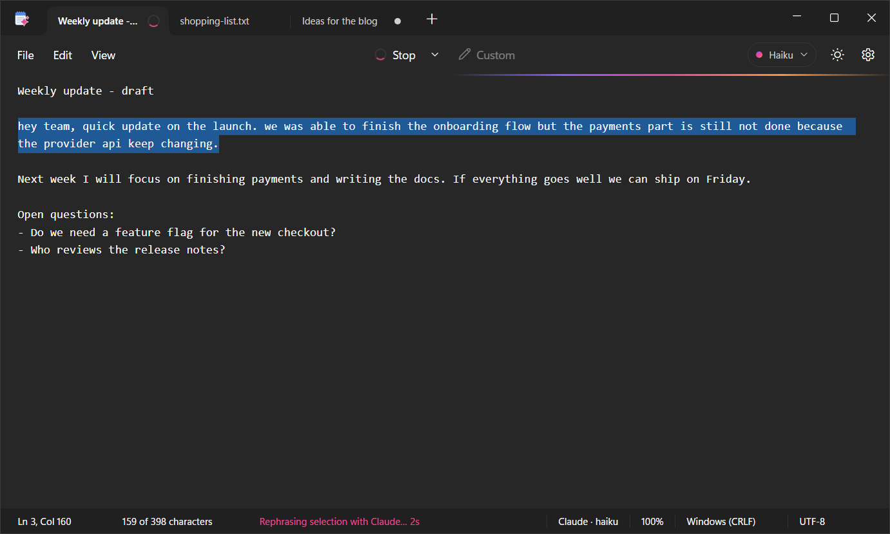
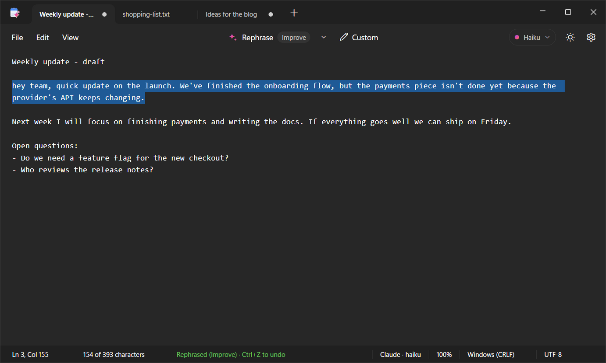
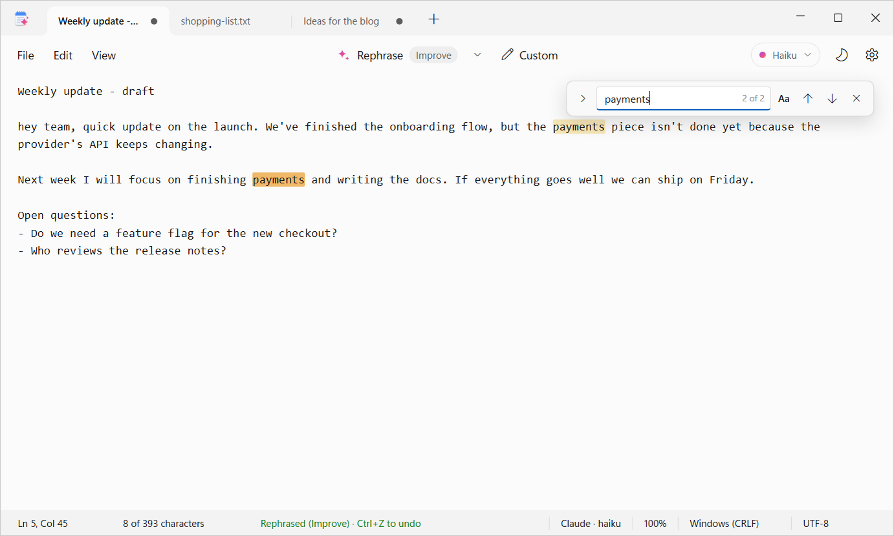
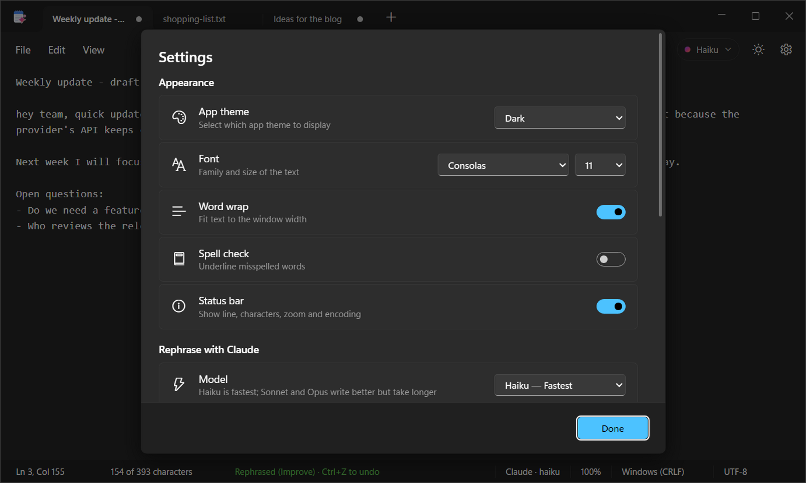

<h1>
  
  NoteAI
</h1>

**A Windows 11 Notepad look-alike that rephrases your writing with one keystroke, powered by the
[Claude Code](https://claude.com/claude-code) already installed on your PC.**

Select some text, press <kbd>Ctrl</kbd>+<kbd>R</kbd>, and Claude rewrites it in place. Don't like
the result? <kbd>Ctrl</kbd>+<kbd>Z</kbd> puts the original back. You don't need an API key or a new
account: NoteAI uses your existing Claude Code login.



## Features

**Rephrasing with Claude**
- Seven built-in styles: Improve, Fix grammar, More formal, More casual, Shorter, Longer and Simpler.
- **Custom instructions** like "translate to English", "turn it into bullet points" or "write it as a polite email".
- Rewrites the selection, or the whole note when nothing is selected.
- The result **replaces the text right away** and stays selected, so you can rephrase again. One <kbd>Ctrl</kbd>+<kbd>Z</kbd> undoes it.
- Optional preview mode lets you review and edit the rewrite before applying it.
- Choose the model: **Haiku** (fastest), **Sonnet** or **Opus**.
- Claude is instructed to answer in the language of your text and to leave names, numbers and links unchanged.

**A real Notepad**
- Tabs in the title bar with native Windows window controls. Drag tabs to reorder them. Untitled tabs are named after their first line.
- **Never lose a note.** Close the window and everything comes back next time, including text you never saved to a file.
- Single window: opening NoteAI or a `.txt` file again adds a tab to the window that's already open.
- Find and replace with every match highlighted, plus Go to line, zoom and Time/Date.
- Spell check with right-click suggestions.
- Light, dark, or follow Windows.
- Keeps each file's encoding (UTF-8, UTF-8 with BOM, UTF-16, ANSI) and line endings (CRLF / LF).

| Rephrasing… | …done. <kbd>Ctrl</kbd>+<kbd>Z</kbd> to undo |
|---|---|
|  |  |

| Light theme with find | Settings |
|---|---|
|  |  |

## Requirements

- Windows 10 or 11
- [Node.js](https://nodejs.org/) 20 or newer (only needed to build the app)
- [Claude Code](https://claude.com/claude-code), installed and signed in. Run `claude` once in a
  terminal to log in. Rephrasing uses your Claude Code plan or API usage.

## Install

```bash
git clone <this-repo-url> note-ai
cd note-ai
npm install
npm run install-app
```

`npm run install-app` builds `NoteAI.exe` and installs it for your Windows user (no admin rights needed):

- the app goes to `%LOCALAPPDATA%\Programs\NoteAI\NoteAI.exe`
- shortcuts are added to the **Start menu** and the **Desktop**

**Pin it to the taskbar:** open NoteAI, right-click its taskbar icon, and choose **Pin to taskbar**.
Windows doesn't allow apps to pin themselves.

To update after pulling new code, run `npm run install-app` again. It closes a running NoteAI
normally first, so your open tabs are saved.

## Using NoteAI

### Rephrase

| Shortcut | Action |
|---|---|
| <kbd>Ctrl</kbd>+<kbd>R</kbd> | Rephrase with the current style (shown on the Rephrase button) |
| <kbd>Ctrl</kbd>+<kbd>Shift</kbd>+<kbd>R</kbd> | Rephrase with your own instruction |
| <kbd>Alt</kbd>+<kbd>1</kbd> … <kbd>Alt</kbd>+<kbd>7</kbd> | Improve · Fix grammar · Formal · Casual · Shorter · Longer · Simpler |
| <kbd>Esc</kbd> | Stop a rephrase in progress |
| <kbd>Ctrl</kbd>+<kbd>Z</kbd> | Undo the rephrase |

You can also click **Rephrase** in the toolbar, pick a style from the **˅** menu next to it, or
right-click the text. Picking a style rephrases right away and makes it the default for
<kbd>Ctrl</kbd>+<kbd>R</kbd>. While Claude works, the target text shimmers and is locked so it can't
change underneath the rewrite. You can keep working in other tabs.

### Everything else

| Shortcut | Action |
|---|---|
| <kbd>Ctrl</kbd>+<kbd>N</kbd> / <kbd>Ctrl</kbd>+<kbd>T</kbd> | New tab |
| <kbd>Ctrl</kbd>+<kbd>W</kbd>, middle-click | Close tab (asks to save only if the tab has unsaved changes) |
| <kbd>Ctrl</kbd>+<kbd>Tab</kbd> / <kbd>Ctrl</kbd>+<kbd>Shift</kbd>+<kbd>Tab</kbd> | Next / previous tab |
| <kbd>Ctrl</kbd>+<kbd>O</kbd> | Open files |
| <kbd>Ctrl</kbd>+<kbd>S</kbd> / <kbd>Ctrl</kbd>+<kbd>Shift</kbd>+<kbd>S</kbd> / <kbd>Ctrl</kbd>+<kbd>Alt</kbd>+<kbd>S</kbd> | Save / Save as / Save all |
| <kbd>Ctrl</kbd>+<kbd>F</kbd> / <kbd>Ctrl</kbd>+<kbd>H</kbd> | Find / Replace (<kbd>Enter</kbd> next, <kbd>Shift</kbd>+<kbd>Enter</kbd> previous) |
| <kbd>F3</kbd> / <kbd>Shift</kbd>+<kbd>F3</kbd> | Find next / previous |
| <kbd>Ctrl</kbd>+<kbd>G</kbd> | Go to line |
| <kbd>F5</kbd> | Insert time and date |
| <kbd>Ctrl</kbd>+<kbd>+</kbd> / <kbd>Ctrl</kbd>+<kbd>-</kbd> / <kbd>Ctrl</kbd>+<kbd>0</kbd> | Zoom in / out / reset (or <kbd>Ctrl</kbd>+mouse wheel) |
| <kbd>Ctrl</kbd>+<kbd>,</kbd> | Settings |
| <kbd>Alt</kbd>+<kbd>F</kbd> / <kbd>E</kbd> / <kbd>V</kbd> | Open the File / Edit / View menu |

Closing the window never asks to save. Every tab, including unsaved and untitled ones, is restored
the next time you open NoteAI. Closing the **last tab** closes the window, like Notepad.

## How rephrasing works

NoteAI doesn't talk to any server itself. For each rephrase it runs the Claude Code CLI on your
machine:

```
claude -p --model <haiku|sonnet|opus> --tools "" --strict-mcp-config --no-session-persistence --system-prompt "<rephrase rules>"
```

The selected text and the instruction are sent on stdin. Claude replies with only the rewritten text.

- **No tools:** `--tools ""` and `--strict-mcp-config` turn off every tool and MCP server, so Claude
  can't read files, run commands or browse. It only sees the text you send.
- **No project context:** the CLI runs from your temp folder, so no `CLAUDE.md` or project settings are picked up.
- **No history clutter:** `--no-session-persistence` keeps rephrases out of your Claude Code session list.
- The text you rephrase is sent to Anthropic through Claude Code, under your account's terms, like
  any other Claude Code request.

NoteAI finds Claude Code on your `PATH`, in `%USERPROFILE%\.local\bin\claude.exe` or in
`%APPDATA%\npm\claude.cmd`. A rephrase times out after 3 minutes.

## Where your data lives

| Location | Contents |
|---|---|
| `%APPDATA%\NoteAI\settings.json` | Theme, font, zoom, model, default style, window position |
| `%APPDATA%\NoteAI\session\` | Open tabs (`index.json`) and their unsaved text (one `.txt` per tab) |
| `%APPDATA%\NoteAI\electron\` | Chromium's cache and spell-check dictionary |
| `%LOCALAPPDATA%\Programs\NoteAI\` | The installed app |

Your files are only written when you save. Unsaved text lives in the session folder until you save or
close its tab.

**Uninstall:** close NoteAI, then delete `%LOCALAPPDATA%\Programs\NoteAI`, the two `NoteAI`
shortcuts (Start menu and Desktop), and optionally `%APPDATA%\NoteAI`.

## Troubleshooting

| Problem | Fix |
|---|---|
| "Claude Code was not found" | Install Claude Code, open a new terminal, and check that `claude --version` works. Then restart NoteAI. **Settings → Claude Code** shows the path NoteAI found. |
| "Rephrase failed" mentioning login or authentication | Run `claude` in a terminal and sign in, then try again. |
| Rephrasing is slow | Switch the model chip (top right) to **Haiku**. Sonnet and Opus are slower but write better. |

## Development

```bash
npm install
npm start            # run from source
npm run install-app  # build and install NoteAI.exe
npm run icon         # redraw assets/icon.ico and icon.png (needs Python + Pillow)
```

No framework and no bundler: Electron, plain HTML/CSS and vanilla JavaScript.

```
src/
  main.js       Main process: window, file I/O, session cache, Claude Code bridge
  preload.js    The small API the page is allowed to call
  index.html    Layout: title bar with tabs, command bar, editor, status bar
  styles.css    Windows 11 Notepad styling, light and dark tokens
  renderer.js   Tabs, editor, menus, find/replace, rephrase flow, settings
scripts/
  install.js    Packages NoteAI.exe and installs it with shortcuts
  make_icon.py  Draws the app icon
assets/         icon.ico, icon.png
docs/           Architecture notes and screenshots
```

- [docs/ARCHITECTURE.md](docs/ARCHITECTURE.md) explains how the pieces fit together.
- [CONTRIBUTING.md](CONTRIBUTING.md) covers working on the code.
