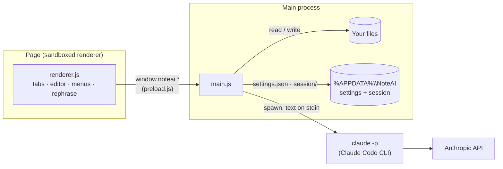
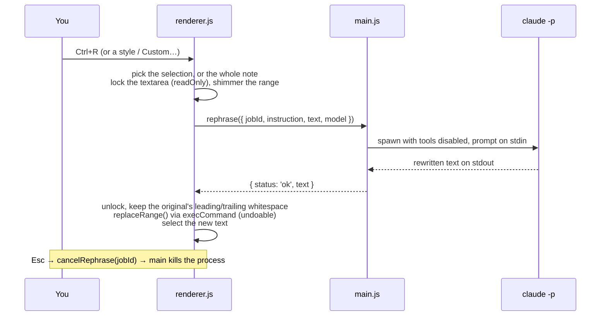

# Architecture

NoteAI is a small Electron app with no framework and no bundler. Three files do most of the work:

| File | Runs in | Responsibility |
|---|---|---|
| [`src/main.js`](../src/main.js) | Main process (Node.js) | Window, single instance, file I/O, encodings, session cache, settings, spawning Claude Code, shortcuts |
| [`src/preload.js`](../src/preload.js) | Preload (isolated) | Exposes a fixed `window.noteai` API to the page through `contextBridge` |
| [`src/renderer.js`](../src/renderer.js) | Page (sandboxed) | Tabs, editor, menus, dialogs, find/replace, rephrase flow, keyboard shortcuts |



## Window

- `titleBarStyle: 'hidden'` plus `titleBarOverlay` lets the page draw the tab strip in the title
  bar while Windows draws the real minimize, maximize and close buttons, including Snap Layouts.
  `main.js` recolors the overlay whenever the theme changes (`applyWindowChrome`).
- The title bar region is `-webkit-app-region: drag`. Tabs and buttons opt out with `no-drag`.
- `Menu.setApplicationMenu(null)` removes Electron's default menu, so <kbd>Ctrl</kbd>+<kbd>R</kbd>
  doesn't reload the page. The File/Edit/View menus are HTML drawn by `renderer.js`.
- Closing the window doesn't close it right away. `main.js` cancels the close, sends
  `request-close`, the page flushes the session cache, and then it calls `closeWindow()`. If the
  page doesn't answer within 4 seconds, the window closes anyway; the cache is saved continuously.

## Editor

Each tab owns its own `<textarea>`. Hidden tabs keep their element, so **each tab keeps its own
native undo history**.

- **Undoable edits.** Every programmatic change (rephrase, replace, replace all, Time/Date) goes
  through `replaceRange()`, which selects the range and calls `document.execCommand('insertText')`.
  That puts the change on the textarea's own undo stack, so one <kbd>Ctrl</kbd>+<kbd>Z</kbd> reverts
  it. Assigning `textarea.value` would wipe the undo history, so the code only does that when it
  first loads a file.
- **Highlights.** A textarea can't color part of its text, and Chromium hides a textarea's selection
  when it loses focus. So `#highlights` is a mirror `<div>` behind the active textarea, with the same
  font, padding, wrapping and scroll position. `renderHighlights()` fills it with transparent text
  and `<mark>` elements for find matches and the shimmering "being rephrased" range.
  `syncHighlightScroll()` keeps the two scrolled together. Both always reserve the vertical
  scrollbar (`overflow-y: scroll`), so their lines wrap at the same width.
- **Spell check** is Chromium's, which uses the Windows spell checker. Right-click goes to
  `main.js` (`context-menu`), which sends the suggestions to the page. The page shows them in its
  own themed menu and calls `replaceMisspelling` / `addToDictionary`.

## Rephrase flow



Details in `main.js`:

- **Command:** `claude -p --model <m> --tools "" --strict-mcp-config --no-session-persistence --system-prompt <SYSTEM_PROMPT>`.
- **Working folder:** `os.tmpdir()`, so no project `CLAUDE.md` is loaded.
- **Prompt:** `Instruction: …` followed by the text wrapped in `<text>` tags. The system prompt asks
  for the rewritten text only, in the same language, with names, numbers and links unchanged.
- **Cleanup:** `cleanResult()` strips a stray code fence or `<text>` wrapper from the reply.
- **Timeout:** 3 minutes (`CLAUDE_TIMEOUT_MS`). Running jobs are tracked in `jobs` by `jobId`, so
  they can be cancelled.
- **`claude.cmd`:** if Claude Code was installed through npm as `claude.cmd`, it runs through
  `cmd.exe` with quoted arguments. Recent Node versions refuse to spawn `.cmd` files directly.

Only one rephrase runs at a time. If you close its tab, the job is cancelled. If you switch tabs, the
result is applied when it arrives, and NoteAI switches back to that tab.

## Session cache (never losing a note)

The page calls `saveSession()` 800 ms after an edit, and 2 s after a scroll or tab switch. It also
calls it before the window closes. Only tabs whose text changed since the last write send their
content.

```
%APPDATA%\NoteAI\session\
  index.json      { version: 2, selected, tabs: [{ id, path, encoding, eol, cached, cursor, scroll }] }
  <id>.txt        the tab's text, written only when `cached` is true
```

A tab is `cached` when it has unsaved changes, or when it is an untitled tab with text. Saved, clean
tabs are reopened from their file on disk instead. Writes are atomic (`*.tmp` then rename), and
`.txt` files for tabs that no longer exist are deleted. `loadSession()` also reads the format written
by NoteAI 1.x: Tk-style `"line.col"` cursors and the `cp1252` / `utf-16` encoding names.

## Files and encodings

`readTextFile()` detects:

| Bytes | Encoding | Saved as |
|---|---|---|
| `EF BB BF` | `utf-8-bom` | UTF-8 with BOM |
| `FF FE` | `utf-16le` | UTF-16 LE with BOM |
| `FE FF` | UTF-16 BE (converted) | UTF-16 LE with BOM |
| valid UTF-8 | `utf-8` | UTF-8 |
| anything else | `windows-1252` | ANSI, or UTF-8 if the text now has characters ANSI can't hold |

Line endings are normalized to `\n` in the editor. The original style (`crlf` or `lf`) is
remembered and restored on save. New files use CRLF, like Notepad.

## Settings and themes

`settings.json` holds `model`, `style`, `preview`, `theme`, `word_wrap`, `status_bar`, `spellcheck`,
`font_family`, `font_size`, `zoom`, `bounds`, `maximized` and `last_custom`. The page sends partial
updates with `saveSettings()`.

The theme setting (`system` / `light` / `dark`) is applied with `nativeTheme.themeSource`.
`main.js` reports the effective dark/light value back to the page. The page sets
`<html data-theme>`, and every color comes from CSS variables in `styles.css`. When Windows switches
themes, `nativeTheme` emits `updated` and the page receives `theme-changed`.

## Single instance

`app.requestSingleInstanceLock()` keeps one NoteAI process. A second launch (Start menu, a pinned
icon, or "Open with" on a `.txt`) passes its arguments through `second-instance`. The running window
opens those files in tabs, or a new blank tab when there are none, and comes to the front.

## IPC API (`window.noteai`)

| Call | Direction | Purpose |
|---|---|---|
| `init()` | page → main | Settings, restored session, files passed on the command line, dark flag |
| `openDialog()` | page → main | Open-file dialog; returns `{ path, text, encoding, eol }` per file |
| `saveDialog(name)` / `saveFile(req)` | page → main | Save-as dialog / write a file in its encoding and line endings |
| `saveSession(payload)` | page → main | Write `session/index.json` and changed tab texts |
| `saveSettings(partial)` | page → main | Merge and persist settings; returns whether the theme is dark |
| `rephrase(req)` / `cancelRephrase(jobId)` | page → main | Run or stop a Claude Code rewrite |
| `claudeInfo()` | page → main | Path and version of the Claude Code CLI, for Settings |
| `replaceMisspelling(w)` / `addToDictionary(w)` | page → main | Spell-check actions |
| `setTitle(t)` / `closeWindow()` | page → main | Window title / finish closing |
| `on('context-menu')` | main → page | Right-click position and spelling suggestions |
| `on('request-close')` | main → page | Flush the session, then call `closeWindow()` |
| `on('open-files')` | main → page | Files from a second launch |
| `on('theme-changed')` | main → page | Windows switched light/dark |

## Security

- The page runs with `contextIsolation: true` and `sandbox: true`. It can only use the calls listed above.
- A strict Content-Security-Policy in `index.html` allows local scripts only, with no remote content.
- Navigation is blocked (`will-navigate`), and new windows are denied. `http(s)` links open in the browser.
- Claude Code runs with every tool and MCP server disabled, so a rephrase can't touch the file system.

## Packaging and install

[`scripts/install.js`](../scripts/install.js) runs `@electron/packager`, which writes
`dist/NoteAI-win32-x64` with an `app.asar` and the icon embedded in `NoteAI.exe`. It then:

1. closes a running NoteAI with a normal `taskkill` (no `/F`), so tabs are saved
2. replaces `%LOCALAPPDATA%\Programs\NoteAI` with the new build
3. runs `NoteAI.exe --install-shortcuts`, which uses `shell.writeShortcutLink` to create Start menu
   and Desktop shortcuts with the app user model ID `NoteAI.Editor`

The packaged app also refreshes the Start menu shortcut on every start. The shortcut's ID matches the
running window, so **Pin to taskbar** pins NoteAI itself rather than a generic Electron icon.

## Environment variables

| Variable | Effect |
|---|---|
| `NOTEAI_DATA_DIR` | Use another folder instead of `%APPDATA%\NoteAI`. Handy for testing without touching your real notes. |
